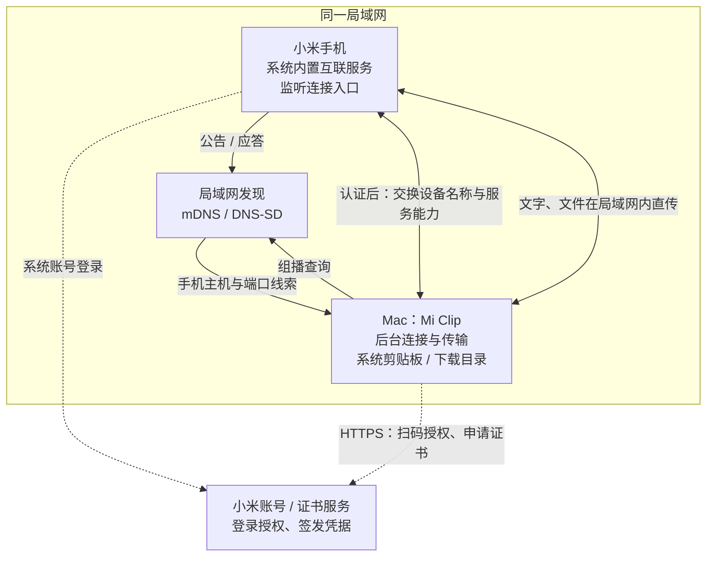
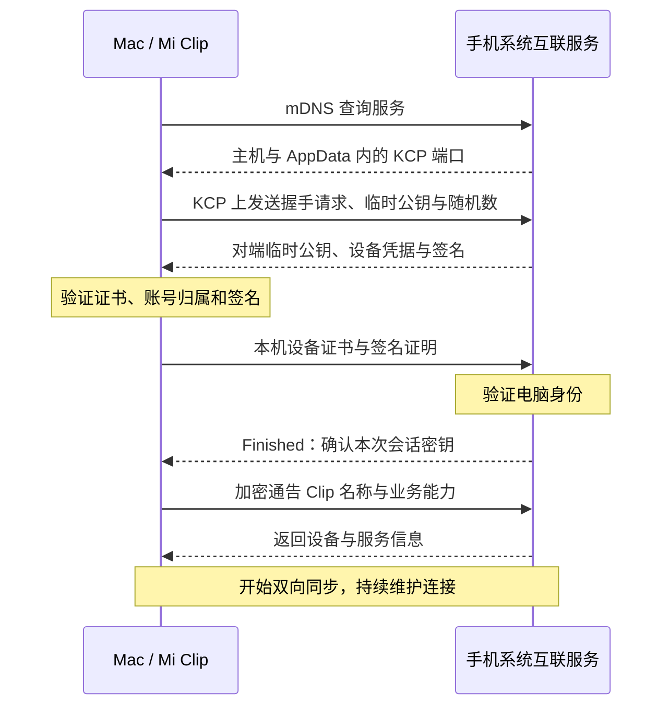

* 目录
{:toc}

## 一、使用场景与部署：谁在手机上，谁在电脑上

我用小米手机和 Mac，希望手机继续使用系统内置的互联服务，电脑只运行一个轻量客户端：[Mi Clip](https://github.com/mnhkahn/mi-clip)。要完成三个动作：手机与 Mac 双向复制文字；手机通过系统分享把文件传到 Mac；Finder 复制图片文件后，在手机微信中粘贴。

接入的是小米 **Xiaomi HyperConnect** 体系。可以先看三份官方资料：[HyperConnect 功能介绍](https://hyperos.mi.com/continuity)、[《设备互联隐私政策》中的“设备发现及连接”和“跨设备剪贴板”](https://privacy.mi.com/Miinterconnectivity/zh_CN/)，以及[小米信任中心的 HyperOS 安全白皮书入口](https://trust.mi.com/en/compliance)。它们说明官方的互联能力、设备身份与安全背景；下面的服务名、报文封装和时序则以 Mi Clip 的实际互操作实现为依据，不能把官方功能说明当成完整的报文规范。

部署只有手机、Mac，以及登录时访问的小米账号和证书服务：

图中的云端负责账号和凭据，不参加局域网广播；本次实现中的剪贴板和文件正文由手机与 Mac 直传。建立初始连接时，手机是监听端，Mac 主动连接；传输文件时，Mac 也会按需监听数据端口。“客户端”与“服务端”是某次连接中的角色，不意味着只能单向发送。

## 二、从广播到连接：先找到对方，再验证身份和能力

**1. 手机公告入口，Mac 发出查询。**

手机通过 mDNS/DNS-SD 暴露 `_lyra-mdns._udp` 服务。Mac 调用 `DNSServiceBrowse` 浏览服务，再用 `DNSServiceResolve` 获取主机和 TXT 记录；其中 `AppData` 是 Base64 编码的小米二进制数据，解析后才能拿到实际 KCP 端口。mDNS 是局域网内的组播查询与应答，DNS-SD 规定服务如何被发现，通用机制见 [RFC 6763](https://www.rfc-editor.org/rfc/rfc6763)。

这里要分清两种常被统称为“广播”的动作：

| 动作 | 发给谁 | 解决什么问题 |
| --- | --- | --- |
| 手机的 mDNS 公告，以及 Mac 的组播查询 | 局域网中的发现参与者 | 找到手机的连接入口 |
| 认证后的设备与服务通告 | 已建立连接的对端，使用加密单播 | 告诉手机“我是 Clip，支持哪些业务” |

当前 Mi Clip 没有注册自己的 mDNS 服务。手机分享页能显示 Clip，是因为连接后收到了电脑的名称和能力通告，不能据此推断“电脑也发布了与手机相同的 mDNS 公告”。

**2. 向发现的端口建连，再进行同账号认证。**

Mac 向手机的 UDP 端口发送 KCP 数据。[KCP](https://github.com/skywind3000/kcp) 用序号、确认、重传和分片重组保证消息可靠送达；上面承载小米自己的握手和业务消息。仅有地址和设备名称还不足以建立信任，因此首次使用还要通过扫码授权，取得账号凭据，并为本地生成的设备密钥申请设备证书。

随后每次连接按以下顺序推进：

Mi Clip 会检查设备证书的签发关系、有效期和账号归属，并验证绑定本次临时公钥的签名。双方通过 **P-256 ECDH** 得到共享秘密，再结合随机数，用 **HKDF-SHA256** 派生会话密钥；校验 `Finished` 后，才能确认对端掌握了对应密钥。后续业务使用 **AES-GCM** 加密并验证消息完整性。

**3. 电脑通告能力，手机才知道该显示什么入口。**

通过身份认证后，Mi Clip 发送设备名 `Clip`、账号标识摘要、网络能力和服务列表：`universalClipboard` 表示剪贴板能力，`miLyraShare` 与 `miLyraShareTransfer` 表示文件分享相关能力。手机也同步自己的设备和服务信息，双方据此选择可用业务。

所以“发现设备”“认证通过”“分享页出现 Clip”是连续的三个阶段。只补上发现广播，或者只连通 UDP，都不足以完成文件分享。连接断开后也必须重新完成认证和能力同步。

## 三、连接之后如何发送：文字推送，文件按业务建立数据流

**文字复制：直接推送小消息。** Mac 通过 `NSPasteboard` 的 `changeCount` 感知剪贴板变化，将短文本放进消息中心的 `universalClipboard` 主题（编号 `2`），加密后经现有连接发送。收到手机文本则写入 Mac 剪贴板，并更新已处理的变化计数，避免再把同一段内容发送回去。当前内联文本上限为 3072 字节。

**复制文件：先通知，粘贴时才取正文。** Finder 同时提供文件 URL 和文件名文本，必须优先识别文件 URL，否则同步过去的只是文件名。Mi Clip 打开选中的普通文件，保存“剪贴板序号 → 文件索引 → 文件引用”的对应关系，先通告序号、文件类型和文件名。

手机在兼容应用中粘贴时，再向 Mac 请求文件信息和指定索引的正文。Mac 校验请求仍属于当前这次复制，回复元数据、发送 SDK 流头，手机接受后才开始按偏移发送数据；完成由手机回执确认。类型也要与原生协议一致，例如本次核对的 HEIC 编号为 `241`，否则手机可能无法提供图片粘贴入口。重新复制会撤销旧文件引用，源文件变化后也需要重新复制。

**手机系统分享：先协商清单，再传文件。** 手机在分享页选择 Clip 后，发起文件服务连接。双方校验文件通道凭据，并把协商的数据端口与密钥绑定到已认证的请求；接着发送文件清单，Mac 接受后开放数据流。两类文件业务的封装不同：

| 业务 | 控制消息的封装 | 文件正文的路径 |
| --- | --- | --- |
| Mac 文件剪贴板 → 手机 | KCP → SDK TLV → 剪贴板 Protobuf | SDK 流帧直接走 KCP，SDK 包用 AES-256-GCM 认证加密 |
| 手机系统分享 → Mac | KCP → SDK TLV → Express TLV → 文件分享 Protobuf | 另行协商 TCP 数据连接，数据块用 AES-128-GCM 认证加密 |

这里的 [Protobuf](https://protobuf.dev/programming-guides/encoding/) 负责按字段编号编码业务数据，TLV 负责表达 SDK 和 Express 的帧类型、标签、长度和值。两种文件功能不能共用同一套封装解析：我们曾把剪贴板 Protobuf 当成 Express TLV 读取，手机就一直停在“粘贴自 Clip”的转圈状态。

接收端逐块验证认证标签、流编号和偏移，确认实际长度与文件清单一致，并收到认证的结束记录后，才把临时文件作为完整结果放进 `~/Downloads`，同名另存。文件剪贴板的发送端则以手机完成回执为准：手机可能在收满声明大小时就确认成功，不应因为本地尚未发送可选结束帧而误报失败。

至此，一次跨设备操作才算闭环：**公告找到入口 → 建立可靠连接 → 验证身份与密钥 → 交换业务能力 → 发送并校验内容 → 确认完成。** 本次已验证双向短文本、手机分享小文件到 Mac，以及 Finder 复制 HEIC 文件后在手机微信粘贴并发送；其他格式和应用的兼容性仍需逐项验证。
